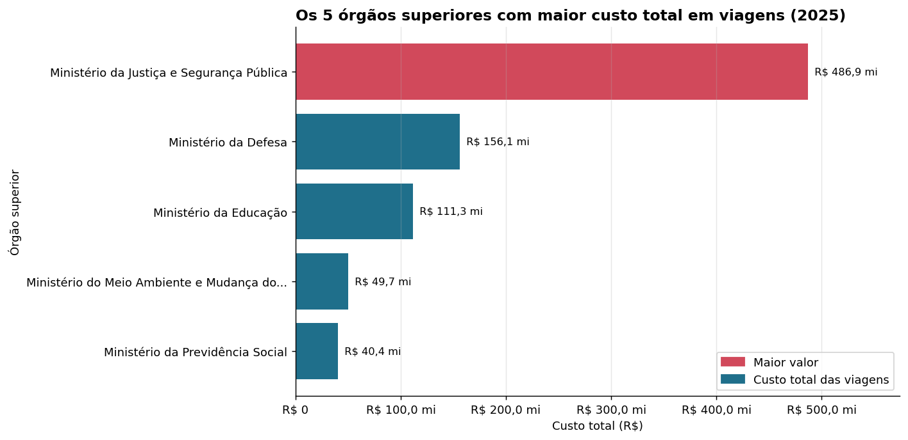
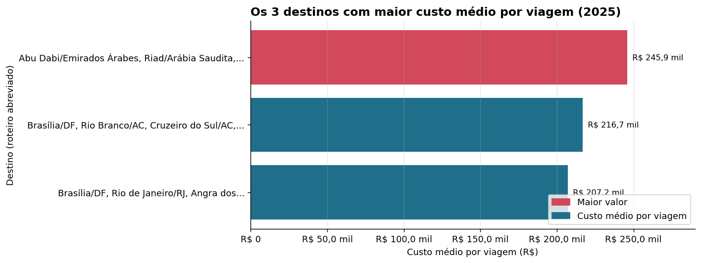
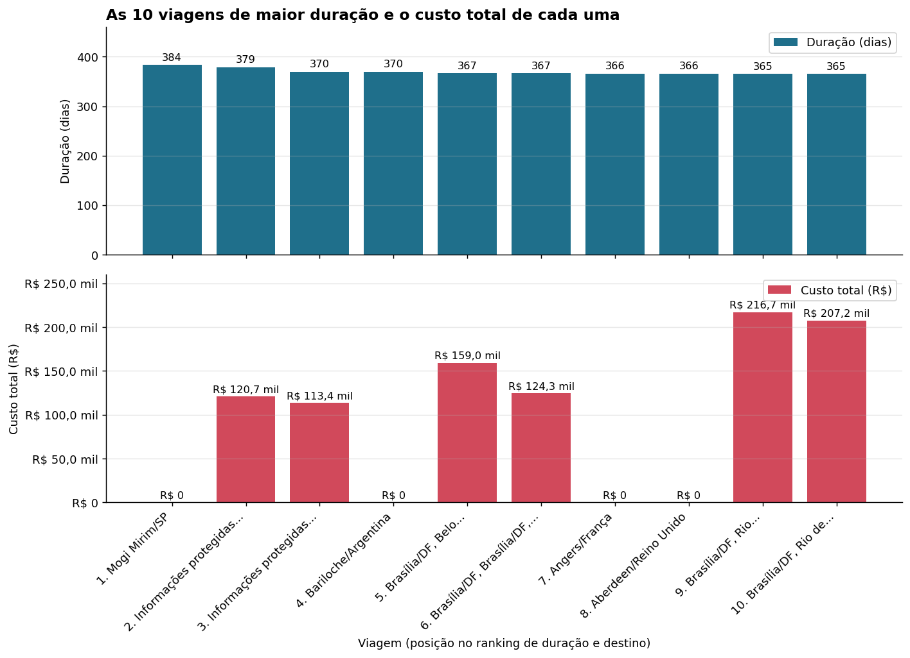
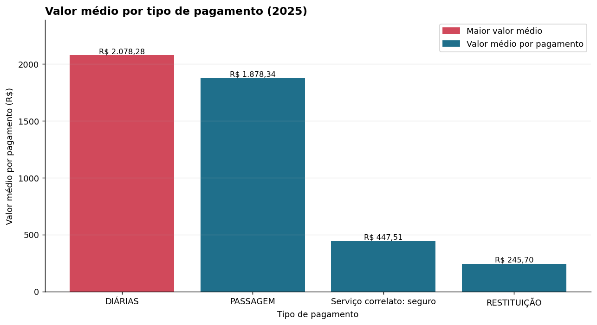
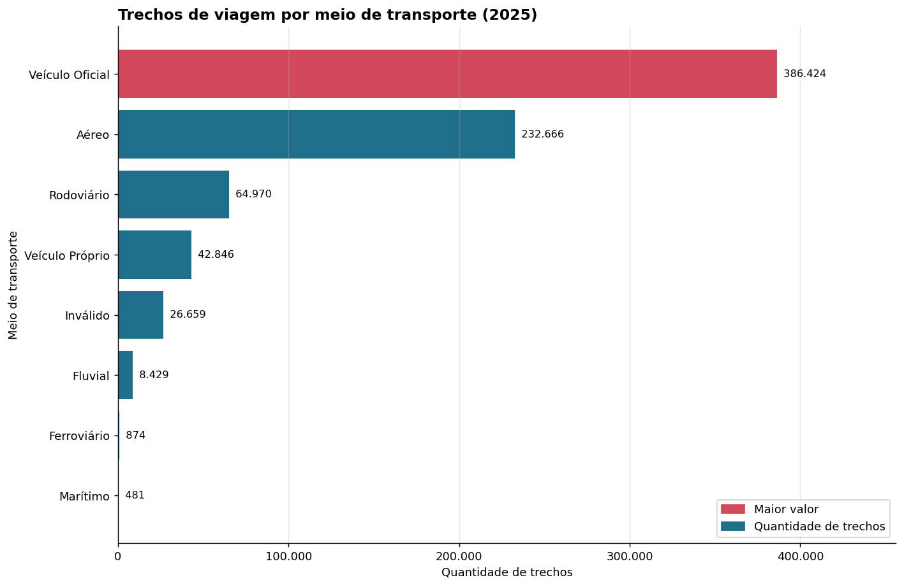
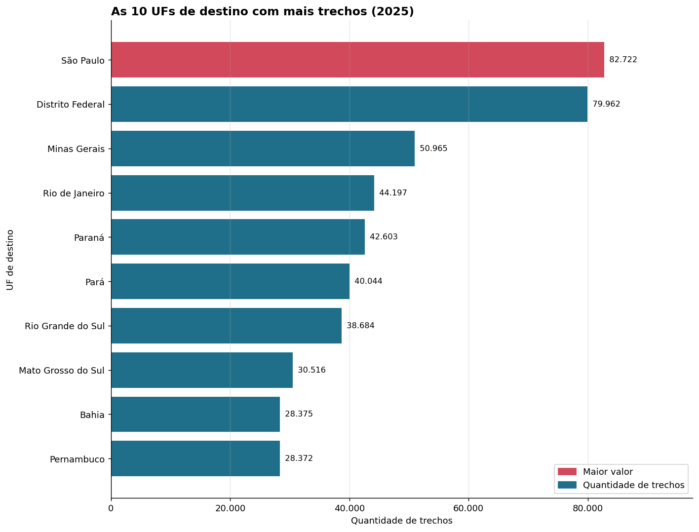
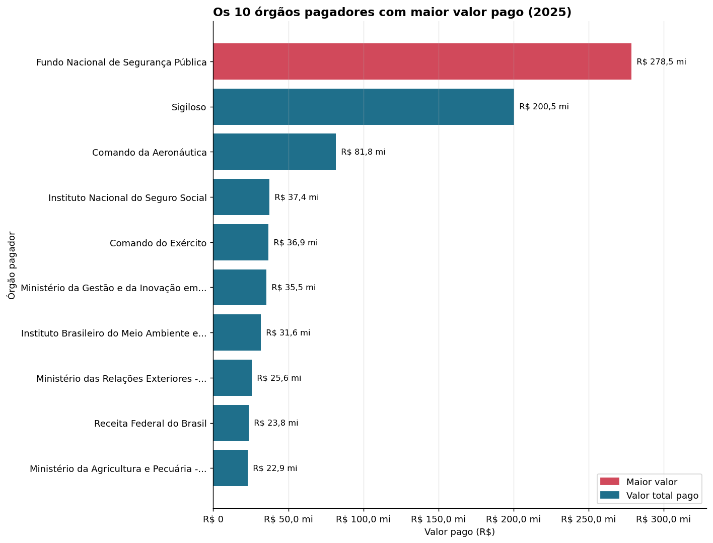

# Pipeline de dados: Viagens a Serviço (Portal da Transparência)

Pipeline ETL em Python + PostgreSQL com a Arquitetura Medallion (Raw, Silver e Gold). Ele baixa os dados
abertos de viagens a serviço do Governo Federal (1º semestre de 2025), organiza em um banco relacional e
responde perguntas sobre os gastos com gráficos.

## Problema que resolve

Os dados do Portal da Transparência chegam brutos: quatro CSVs separados, com vírgula como decimal, datas
em texto (`DD/MM/AAAA`) e sem relação formal entre eles. O projeto transforma isso em tabelas confiáveis,
com tipos corretos e integridade referencial, e entrega métricas e gráficos para quem precisa decidir.

## Arquitetura

```
Google Drive (.zip)
        |  1_extrair.py
        v
 RAW    raw_viagem  raw_pagamento  raw_passagem  raw_trecho      <- cópia fiel, tudo VARCHAR
        |  2_transformar.py
        v
 SILVER silver_viagem  <--FK--  silver_pagamento / silver_passagem / silver_trecho
        |                        tipos DECIMAL e DATE, PK, FK e constraints
        |  3_analise.ipynb
        v
 GOLD   gold_pagamentos, gold_trechos (tabelas) + vw_gold_* (views) -> perguntas e gráficos
```

| Camada | Tabelas | O que acontece |
|---|---|---|
| Raw | `raw_viagem`, `raw_pagamento`, `raw_passagem`, `raw_trecho` | Cópia do CSV inteiro, sem alterar nada |
| Silver | `silver_viagem`, `silver_pagamento`, `silver_passagem`, `silver_trecho` | Conversão de tipos, colunas calculadas, PK/FK e constraints |
| Gold | `gold_pagamentos`, `gold_trechos` e as views `vw_gold_*` | `JOIN` + `GROUP BY` com as métricas de negócio |

## Tecnologias

- Python 3 (pandas, psycopg2, SQLAlchemy, matplotlib, python-dotenv, gdown)
- PostgreSQL
- Jupyter Notebook
- Git/GitHub

## Estrutura do repositório

```
.
├── 0_criar_banco.sql    # database + 8 tabelas (4 Raw e 4 Silver) com PK, FK e constraints
├── 1_extrair.py         # download do zip + carga da camada Raw
├── 2_transformar.py     # Raw -> Silver (tipagem, limpeza e colunas calculadas)
├── 3_analise.ipynb      # camada Gold, perguntas de negócio e gráficos
├── config.py            # parâmetros e leitura do .env
├── banco.py             # conexão e funções utilitárias do banco
├── requirements.txt
├── .env.example         # modelo de credenciais
├── .gitignore
├── data/                # CSVs baixados (ignorados pelo Git)
└── docs/                # imagens dos gráficos
```

## Como executar

1. Instale as dependências:
   ```bash
   pip install -r requirements.txt
   ```
2. Copie `.env.example` para `.env` e preencha usuário e senha do PostgreSQL. Informe também o
   `DRIVE_FILE_ID` (o trecho do link do Drive entre `/d/` e `/view`), ou cole o ID direto no `config.py`.
3. Crie o banco e as tabelas:
   ```bash
   psql -U postgres -f 0_criar_banco.sql
   ```
   No pgAdmin, rode o `CREATE DATABASE` sozinho, abra uma conexão no banco `viagens_transparencia` e rode o
   restante do arquivo (sem a linha `\connect`).
4. Extraia e carregue a camada Raw:
   ```bash
   python 1_extrair.py
   ```
   Se os CSVs já estiverem em `data/`, o download é pulado. Use `--forcar-download` para baixar de novo.
5. Gere a camada Silver:
   ```bash
   python 2_transformar.py
   ```
6. Abra o `3_analise.ipynb` e execute todas as células. Ele cria a camada Gold e gera os gráficos.

Os passos 4 e 5 podem ser repetidos sem duplicar dados: cada tabela é esvaziada (`TRUNCATE`) antes da carga,
e a carga acontece em uma transação (se algo falhar, o estado anterior é mantido).

## Decisões de projeto

- **Raw fiel:** todas as colunas do CSV (inclusive as que a Silver não usa) são copiadas como texto. O
  cabeçalho original é trocado por nomes em snake_case.
- **Leitura em blocos:** os CSVs têm de 40 MB a 200 MB; são lidos em blocos de 20 mil linhas e inseridos em
  lotes de 5 mil.
- **`valor_total`** = diárias + passagens + outros gastos − devolução.
- **`duracao_dias`** conta o dia de início e o de fim (25/01 a 01/02 = 8 dias). Para usar só a diferença
  entre as datas, altere `DURACAO_INCLUSIVA` no `config.py` e rode o passo 5 de novo.
- **Linhas rejeitadas na Silver:** id vazio ou repetido, valores negativos e filhos sem viagem
  correspondente não entram, e o `2_transformar.py` informa quantas foram. Nesta carga, nenhuma linha foi
  rejeitada.
- **Pagamentos repetidos foram mantidos:** existem 38 mil linhas idênticas em `silver_pagamento`, mas não
  há chave natural que diferencie duplicata de pagamento legítimo (várias diárias iguais na mesma viagem).
  Removê-las subestimaria o gasto.
- **Categorias da fonte mantidas:** valores como `Inválido` (meio de transporte) e `Sigiloso` (órgão
  pagador) vêm do dado original e não foram alterados.
- **Dois órgãos diferentes:** a pergunta 1 usa o órgão *superior* da viagem; a pergunta 7 usa o órgão
  *pagador*.

## Perguntas de negócio e resultados

Tudo foi calculado sobre 341.860 viagens, 606.916 pagamentos, 167.260 passagens e 763.349 trechos.

| # | Pergunta | Resposta |
|---|---|---|
| 1 | 5 órgãos com maior custo total | Justiça e Segurança Pública (R$ 486,9 mi), Defesa (R$ 156,1 mi), Educação (R$ 111,3 mi), Meio Ambiente e Mudança do Clima (R$ 49,7 mi) e Previdência Social (R$ 40,4 mi) |
| 2 | 3 destinos com maior custo médio | Os três são viagens únicas (de R$ 207 mil a R$ 246 mil); com mínimo de 30 viagens, aparecem roteiros com vários trechos em Brasília (acima de R$ 97 mil) |
| 3 | Viagem de maior duração e seu custo | 384 dias (13/01/2025 a 31/01/2026), Mogi Mirim/SP, custo total R$ 0,00 |
| 4 | Tipo de pagamento com maior valor médio | Diárias, com R$ 2.078,28 por pagamento |
| 5 | Meio de transporte mais usado nos trechos | Veículo oficial, 386.424 trechos (50,6%) |
| 6 | UF de destino em mais trechos | São Paulo, com 82.722 trechos |
| 7 | Órgão que pagou mais no total | Fundo Nacional de Segurança Pública, R$ 278,5 mi (23,3% do total pago) |

### Gráficos

| | |
|---|---|
|  |  |
|  |  |
|  |  |
|  | |

## Conclusões

- A despesa é concentrada: cinco órgãos superiores ficam com cerca de 71% do custo total (R$ 1,19 bilhão) e
  só o Ministério da Justiça e Segurança Pública com 41%.
- Diárias (R$ 834 mi) e passagens (R$ 355 mi) são praticamente toda a despesa.
- Custo médio por destino e duração das viagens precisam de cautela: os primeiros colocados são casos
  isolados e a viagem mais longa tem custo zero.
- O Fundo Nacional de Segurança Pública e a categoria "Sigiloso" somam 40% do valor pago. Como "Sigiloso"
  não identifica o órgão, uma parte relevante do gasto não pode ser atribuída a ninguém.

## Melhorias possíveis

- Separar o campo `destinos` (lista de cidades) em uma tabela própria para analisar destino por destino.
- Criar uma dimensão de datas para análises por mês.
- Validar a soma de `silver_pagamento` contra `valor_total` de cada viagem.
- Agendar o pipeline (cron ou Airflow) e usar `COPY` para cargas maiores.
- Testes automatizados para as funções de conversão.
